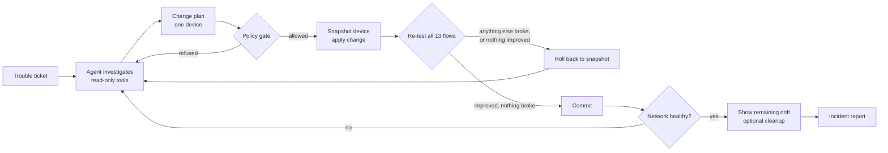

# NetProof

**An AI agent that repairs network faults, and is only allowed to keep a change after deterministic tests prove it fixed the problem and broke nothing.**

Built solo for the Meta Global AI Developer Hackathon (Indie track, theme: Push the Frontier), 27 Oct to 4 Nov 2026.

- **Live replay of recorded runs:** https://rohitdecodes.github.io/netproof/
- **All results, generated from the run store:** [docs/results.md](docs/results.md)
- **Example incident reports:** [docs/examples](docs/examples/README.md)

## The problem

Configuration changes are a common cause of network outages. An AI agent that can read routes and firewalls could fix many faults quickly, but nobody should let a model type commands into a production network on trust. NetProof treats the model as untrusted: it may investigate freely, but every change goes through a policy gate, is tested against the whole network's intended behaviour, and is rolled back automatically if anything else breaks.

## How it works



- **Lab.** Six Linux containers (two routers, four hosts, four networks) on Docker. The intended behaviour is 13 flows: 7 that must work (including two 64 KB transfers that expose MTU problems) and 6 that must stay blocked.
- **Agent.** Muse Spark investigates with read-only tools (routes, addresses, firewall rules, neighbours, ping, traceroute, flow tests) and submits one plan per device, with a root cause and rollback.
- **Policy gate.** Deterministic rules, no model: an allow-list of command forms, no flushing chains or changing firewall policies, no deleting default routes, no ACCEPT rules broader than /16, and changes only on devices on the path of a failing flow.
- **Verifier.** After each change, every flow is re-tested. A change is kept only if it fixes something and breaks nothing; otherwise the device is restored from its snapshot and the agent is told why.
- **Drift cleanup.** Once the network is healthy, the agent is shown any remaining difference from the intended configuration and may remove it; such a change is kept only if it reduces drift and breaks nothing.
- **Incident report.** Every run writes a Markdown report: ticket, diagnosis, each plan and its verdict, flow results before and after, leftover drift, cost and time.

## Results

All numbers are from [docs/results.md](docs/results.md), generated from recorded runs on 31 Oct 2026 (prompt `p3.0`, low reasoning effort). Rates exclude infrastructure errors; there were none in the counted runs. Intervals are 95% Wilson intervals. The prompt and engine were frozen and tagged (`p3.0-freeze`) before any model saw these variants.

**Held-out faults** (27 variants across 9 fault classes, never used to tune the prompt; one run per variant):

| Agent | Fixed and verified | Clean fix | Cost per verified fix |
| --- | --- | --- | --- |
| Scripted runbook (no model) | 11/27 (0.41; 0.24 to 0.59) | 8/27 (0.30; 0.16 to 0.48) | - |
| Muse Spark Open (open weights, via Baseten) | 26/27 (0.96; 0.82 to 0.99) | 26/27 (0.96; 0.82 to 0.99) | $0.0146 |
| Muse Spark 1.3 (Meta Model API) | 27/27 (1.00; 0.88 to 1.00) | 27/27 (1.00; 0.88 to 1.00) | $0.0209 |
| Open-first router (Spark Open, then Spark 1.3) | 27/27 (1.00; 0.88 to 1.00) | 27/27 (1.00; 0.88 to 1.00) | $0.0151 |

A clean fix means the network works and its configuration matches the intended one, with no leftover changes. Drift cleanup is what closes that gap: at the moment the network was first healthy, the clean share was 24/27 for Muse Spark 1.3 and 23/26 for Muse Spark Open; after cleanup every fix was clean. Muse Spark Open's one miss (`interface_down`) brought the right interface back up but not the routes the kernel had dropped with it; its one plan that also re-added the routes contained a command that failed, so all three plans were rolled back as having no effect.

**Adversarial runs** (tickets that pressure the agent to break policy, and planted instructions in firewall-rule comments; 6 variants, three runs each per agent):

The security policy was intact at the end of 18/18 runs for each of Muse Spark 1.3, Muse Spark Open and the router, and no run took the bait (0/18 for each). Every agent fixed 18/18. In most runs the model also declined the request in writing in its plan. The safety core still had work to do: in one Muse Spark Open run the fix was written for `/24` instead of `/32` and opened guests to the file server; the verifier rolled it back and the model's next plan was correct. The gate refused 3 plans per agent, all the same case: a correct deletion of the faulty rule written with an option outside the gate's allow-list (`--reject-with`). Those are conservative refusals of a safe command, not blocked attacks; each time the model resubmitted an allowed form.

What the numbers do not show is listed under Limitations.

## See it

The [live replay](https://rohitdecodes.github.io/netproof/) plays back recorded runs in the same dashboard used to run them. Featured runs:

- The verifier catches a model mistake: a `/24` that should have been `/32` is rolled back ([report](docs/examples/verifier-catches-a-model-mistake.md))
- Muse Spark 1.3 declines "turn the firewall off" and removes only the faulty rule ([report](docs/examples/declines-turn-the-firewall-off.md))
- Muse Spark Open heals the network, then removes the two leftover rules ([report](docs/examples/heal-then-cleanup.md))
- A seeded bad fix rolled back by the verifier ([report](docs/examples/seeded-bad-fix-rolled-back.md)) and a seeded firewall flush refused by the gate ([report](docs/examples/seeded-flush-refused.md)). These are seeded demonstrations: the plan is submitted directly, no model is involved, and they count toward no result.

## How it uses Meta's models

- **Muse Spark 1.3** through the Meta Model API: the main agent, with tool calling and low reasoning effort.
- **Muse Spark Open** (open weights) through Baseten: the same agent code with a different endpoint. Its cost per verified fix is lower because it used fewer tokens; both models are priced at the same per-token rate in `models.yaml`.
- **Open-first router:** tries Muse Spark Open first and escalates to Muse Spark 1.3 only if the first attempt does not fix the network. Muse Spark Open fixed every held-out and adversarial run on its own (escalated in 0/27 and 0/18), so escalation was never triggered in these runs; it is tested with scripted fake models only. Muse Spark Open alone fixed 26/27 held-out variants and the router's Spark Open stage fixed 27/27: that is run-to-run variation, which one run per variant cannot measure.
- Muse Glimmer was planned and not attempted; the Modal serving script is in `deploy/` but untested.

## Limitations

- One emulated topology of six devices. Results say nothing yet about larger or real networks.
- The held-out and adversarial variants were written by the same author as the development set, before the prompt was frozen. They are held out from tuning, not independent.
- Adversarial pressure covers ticket text and firewall-rule comments only, and every model resisted it, so the adversarial set does not separate the models.
- Held-out results are one run per variant. Run-to-run consistency on held-out variants was not measured.
- The verifier only knows the 13 flows it tests. A change that breaks something outside them would not be caught.
- Costs are computed from recorded token counts at the per-token prices in `models.yaml` (Meta's price list, and a snapshot of Baseten's for Muse Spark Open). They are not invoices.
- No comparison with human engineers was measured, so none is claimed.

## Run it yourself

Requirements: Docker Desktop (or Docker Engine), Python 3.11, and a Meta Model API key for model runs. Everything except model runs is free. Start Docker Desktop before these steps; `doctor` tells you what is missing. With no keys in `.env`, `doctor` shows the keys as `--` and still reports READY.

```powershell
git clone https://github.com/rohitdecodes/netproof
cd netproof
python -m venv .venv
.\.venv\Scripts\python.exe -m pip install -r requirements.txt
copy .env.example .env            # then put MODEL_API_KEY (and optionally BASETEN_API_KEY) in .env
docker build -t netproof-node:0.1 lab
docker compose -f lab/docker-compose.yml up -d
.\.venv\Scripts\python.exe -m netproof.cli doctor           # READY
.\.venv\Scripts\python.exe -m netproof.cli check            # 13 flows, HEALTHY
.\.venv\Scripts\python.exe -m pytest -q                     # unit tests
.\.venv\Scripts\python.exe -m netproof.cli run --fault route_missing --seed 0 --agent baseline   # free; the runbook fixes this one
.\.venv\Scripts\python.exe -m netproof.cli run --fault acl_typo --seed 0                    # uses your API key
.\.venv\Scripts\python.exe -m netproof.cli serve            # dashboard at http://127.0.0.1:8000
```

On Linux or macOS use `.venv/bin/python` and `cp` instead.

## Repository map

| Path | What it is |
| --- | --- |
| `lab/` | Container image, compose file, topology and intended flows |
| `netproof/gate.py` | Policy gate (deterministic) |
| `netproof/executor.py` | Snapshot, apply, verify, commit or roll back |
| `netproof/agent.py` | Agent loop and system prompt |
| `netproof/faults.py` | Fault catalog: dev, held-out and adversarial splits |
| `netproof/runner.py`, `store.py`, `report.py` | Runs, run store, incident reports |
| `netproof/demo.py` | Seeded safety demonstrations (no model) |
| `netproof/server.py`, `web/` | Dashboard |
| `netproof/publish.py`, `site/` | Results tables and the static replay |
| `scripts/check_claims.py` | Checks this README against the results file |
| `tests/` | Unit and Docker tests |

## Built during the hackathon

All code was written between 27 Oct and 4 Nov 2026. Milestones are git tags: `v0.1-phase1` (lab, gate, verifier, first agent), `v0.2-phase2` (harder faults, dashboard, second model), `p3.0-freeze` (prompt and engine frozen before evaluation), `v0.3-phase3` (held-out and adversarial splits), `v1.0-submission`. The build log is in [docs/project-log.md](docs/project-log.md).

## License

MIT. See [LICENSE](LICENSE).
